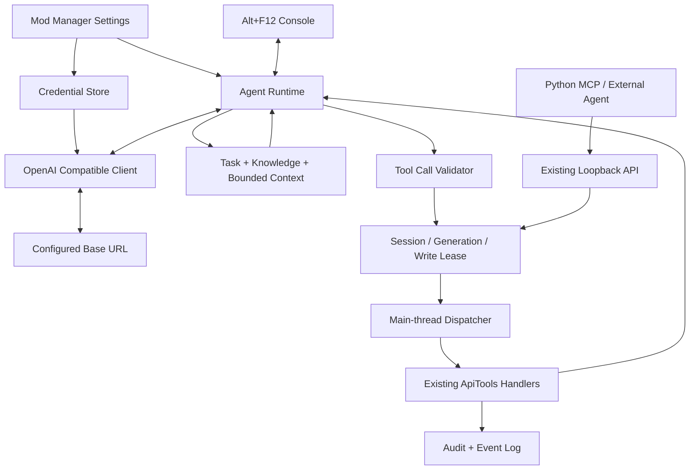
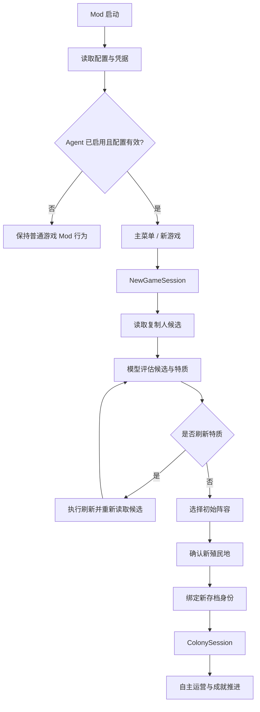

# ONI 内置轻量 Agent v1：最终实施方案

**版本：v1.2 Final**
**日期：2026-11-07**
**仓库：** https://github.com/ZAHOASPLUS/oni-ai-colony-agent
**性质：最终架构与实施方案，不代表代码已经实现、构建或通过实机测试。**

---

## 1. 产品目标与冻结决策

本项目首版的目标是：将一个轻量 Agent 直接内置于 Oxygen Not Included 的 Mod 中。玩家在 Mod Manager/Mod 设置中配置 OpenAI 兼容服务，启动新游戏后 Agent 从复制人候选选择、特质刷新和阵容确认阶段开始接管，进入殖民地后使用全部游戏工具自主运营。玩家可以通过 Alt+F12 控制台查看公开决策摘要、工具调用和结果，随时对话纠偏、暂停 Agent、继续或停止。

### 已确认决策

| 项目 | 最终决定 |
|---|---|
| 首版运行模式 | 仅开发与测试模式 |
| 模型接口 | OpenAI Chat Completions 兼容协议，支持 Base URL / API Key / Model ID |
| Agent 接管时机 | 新游戏设置阶段开始，包括复制人选择和特质刷新 |
| L0 | 读取游戏状态，自动允许 |
| L1 | 常规游戏操作，自动允许 |
| L2 | 高影响游戏内操作，自动允许，不逐项审批 |
| L3 | 回档权限，仅允许回到游戏原生 autosave |
| L3 授权 | Limit：玩家在 Mod Manager 配置回档次数上限，额度内 Agent 自主决定 |
| Autosave | 使用 ONI 原生自动存档机制；自动存档间隔由游戏/Mod Manager 设置控制 |
| 回档后 | 重新读取当前状态并恢复 Agent 任务 |
| 游戏暂停 | 由 Agent 自主决定；另提供可选暂停策略 |
| 人工控制 | Alt+F12 控制台，支持对话纠偏、暂停 Agent、继续、停止 |
| 工具接入 | 当前全部游戏工具接入，工具数从 Schema 自动统计 |
| 外部适配器 | 保留 Python / MCP，不作为内置 Agent 的运行依赖 |

### 首版非目标
- 不保证任意模型能完成所有终极成就或官方使命。
- 不实现通用 Codex/Antigravity 替代品。
- 不做多 Agent、多模型路由、向量数据库或复杂插件市场。
- 不实现 OpenAI Responses API；首版只做 Chat Completions tool calling。
- 不做普通玩家发布模式。
- 不允许 Agent 通过任意路径载入/覆盖/删除存档。
- 不允许外部 MCP 与内置 Agent 同时控制同一会话的写操作。

---

## 2. 总体架构

### 核心原则
1. Mod 是游戏状态与操作的唯一执行权威。
2. Agent 只负责观察、规划、选择工具和解释结果。
3. 内置 Agent 直接复用 C# 工具 handler 和主线程 dispatcher，不通过 localhost HTTP 调用自己。
4. 外部 Python/MCP 继续走现有 HTTP API，但必须共享写操作控制权。
5. 所有游戏对象读写都在 Unity 主线程；网络请求与等待在后台异步执行。
6. 工具全量可用不等于每轮发送全量状态；地图、建筑和资源按需查询、分页获取。

---

## 3. 新游戏接管流程

现有 API 主要面向已载入殖民地，因此首版必须增加新游戏阶段的生命周期能力。

### 建议新增工具（最终名称以源码核查为准）
- `get_new_game_state`
- `get_duplicant_candidates`
- `reroll_duplicant_traits`
- `select_starting_duplicants`
- `confirm_new_colony`

必须核实 ONI 当前版本的候选复制人、特质刷新、阵容选择与确认接口。优先调用游戏内部控制器和数据模型，不以鼠标坐标模拟作为首选。刷新后候选 ID 可能变化，必须重新读取，不能复用旧 ID。

新游戏取消、返回主菜单、读档失败或切换存档时，`NewGameSession` 立即失效。确认创建后生成新的 `ColonySession`，并绑定实际存档身份。

---

## 4. 权限模型

### 4.1 权限等级

| 等级 | 权限 | 范围 | 首版策略 |
|---|---|---|---|
| L0 | 只读 | 状态、地图、人物、资源、建筑、科技、事件、进度、候选信息 | 自动允许 |
| L1 | 常规操作 | 挖掘、建造、研究、收获、清扫、拖地、配置、优先级、工作安排、技能 | 自动允许 |
| L2 | 高影响游戏操作 | 拆除标记、取消任务、人员选择、特质刷新、打印舱选择、速度与暂停 | 自动允许，不逐项审批 |
| L3 | 回档 | 回到当前游戏生成的有效 autosave | 由玩家配置次数上限，额度内 Agent 自主决定 |

L2 不弹逐项确认。所有动作仍需经过工具参数校验、会话身份校验、任务代次校验和审计。

L3 不是任意文件载入权限。模型不能提供路径，只能请求系统提供的 autosave 目标标识。

### 4.2 L3：原生 autosave + limit

最终规则：
- 回档范围仅限当前游戏当前殖民地生成的原生 autosave。
- 不允许回档到手动存档、其他殖民地、其他新游戏或任意外部路径。
- 玩家在 Mod Manager 配置 `rollback_max_per_colony`。
- 额度内 Agent 可以自主判断是否回档，不逐次询问。
- 额度耗尽后拒绝新的回档请求；Agent 应在当前进度继续修复，或向玩家报告需要人工决策。
- 回档后重新读取状态、重新规划，不能继续执行回档前的旧工具队列。
- 回档次数账本必须保存在不随游戏 autosave 一起回滚的位置，避免回档后额度复活。

建议默认回档次数为 **3 次/局**，但必须可配置。该默认值是工程建议，不是不可更改的限制。

### 4.3 自动存档频率

使用 ONI 原生自动存档机制，不另建独立 autosave 目录或镜像系统。
- 自动存档频率由游戏本身可提供的设置控制；若 Mod Manager 提供入口，可在 Mod 设置中呈现/调整。
- 默认沿用游戏当前自动存档设置，不擅自改变玩家偏好。
- 如果玩家主动修改频率，应明确展示最终生效值。
- Agent 不应自行更改自动存档频率，除非玩家明确允许 Agent 管理该设置。
- 回档前先读取当前有效 autosave 列表/当前游戏可加载的 autosave slot，再进行选择。
- 如果没有有效 autosave，L3 返回 `no_autosave_available`，Agent 继续当前存档，不得改用手动存档或任意路径。

### 4.4 回档次数账本
- 记录 colony identity、session identity、累计回档次数、最近一次回档时间/周期、回档目标标识、原因和结果。
- 账本放在游戏 autosave 不会回滚的位置（例如用户级 Mod 数据目录），但只保存必要元数据，不复制存档。
- 回档前先原子写入“pending rollback + 扣减额度”记录；成功后更新结果；失败也保留尝试记录，避免反复利用失败路径绕过限额。
- 账本写入失败时拒绝回档（fail-closed）。
- 重启游戏或回档不能重置已消耗额度。
- 新殖民地建立新额度；同一殖民地续载不得重置额度。
- 只允许回档到当前殖民地的 autosave；若游戏无法可靠识别 autosave 与殖民地身份，则 L3 暂时关闭。

### 4.5 AutosaveGuard 的调整（重要修正）
上一版把 autosave 与 TestClone 隔离的要求设计得过重。按用户最新决定，首版使用 ONI 原生 autosave，不额外建立完全隔离的 autosave 镜像系统。

但现有 `AutosaveGuard` 的职责是保护原始存档，可能会禁用自动存档。不能简单删除它或无条件关闭保护。需要改为：
1. 保留 TestClone 的源存档保护和启动 manifest 校验。
2. 允许 ONI 对当前受控测试存档按玩家设置正常生成 autosave。
3. 在实机确认 ONI autosave 的实际命名、目录、轮换和加载入口。
4. 确认自动存档轮换只作用于当前游戏会话的目标存档，不会覆盖源存档或其他存档。
5. 如果现有脚本为了保护源存档而关闭 autosave，调整脚本/Guard 使它保护源存档但允许当前测试存档 autosave。
6. 不另建 autosave 镜像或自定义轮换器。
7. 若 ONI 的原生 autosave 无法可靠区分当前 clone 与源存档，必须保留 L3 关闭状态，先修正 test clone 启动方式；不得冒险打开。

**因此本方案不要求“存档完全隔离”，但要求对当前 clone 的 autosave 写入目标做实机验证。这是保护源存档的最低必要条件。**

---

## 5. 游戏暂停策略

用户决定由 AI 自主决定是否暂停，同时在 Mod Manager 中提供可选项。

`pause_policy`：
- `agent_decides`：默认建议。Agent 可通过 `set_speed(0)` 暂停，完成规划后自行恢复。
- `never_pause`：Agent 不得主动暂停。
- `allow_pause_require_resume`：允许暂停，但必须写明恢复条件；超时未恢复则提醒玩家。

区分三种状态：
- Pause Agent：只暂停 Agent 循环，不改变游戏速度。
- Pause Game：改变 ONI 游戏速度。
- Player Pause：玩家手动暂停；Agent 不得擅自恢复玩家主动设置的暂停。

必须记录 pause owner，防止 Agent 在玩家手动暂停后自动恢复游戏。

---

## 6. OpenAI 兼容接口

首版仅支持 Chat Completions tool calling：
- `POST {BaseURL}/chat/completions`
- `Authorization: Bearer <API Key>`
- 请求包含 `model`、`messages`、`tools`。
- 解析 `choices[0].message.content`、`tool_calls[]`、`finish_reason`、`usage`。
- 每个工具结果以 `role=tool` 和匹配 `tool_call_id` 回传。
- 支持一次响应多个 tool calls，首版串行执行。
- 首版非流式；不实现 Responses API。
- Base URL 规范化，展示最终请求 URL，不自动猜测供应商路径。
- 默认 HTTPS；禁止跨 host redirect 携带 Authorization。
- 限制超时、请求/响应大小、重试次数和 429 退避。

连接测试必须执行无副作用的测试 tool-call 往返，不能调用真实游戏写工具。

---

## 7. Agent Runtime 与人工纠偏

### 7.1 模块
- `AgentConfig`：模型、运行、预算和 pause/rollback 策略。
- `CredentialStore`：Key 加密凭据。
- `OpenAiCompatibleClient`：异步网络请求。
- `AgentRuntime`：单 Agent 循环与状态机。
- `AgentContext`：目标、知识、近期历史。
- `GameToolDispatcher`：统一调用现有 C# handlers。
- `AgentConsole`：Alt+F12 调试控制台。
- `AgentAudit`：日志和审计。
- `RollbackBudgetLedger`：L3 额度持久账本。

### 7.2 线程边界
- Unity 主线程：所有 ONI/Unity 对象读写、工具 handler、UI 更新。
- 后台 worker：HTTP、JSON 解析、延迟/退避、文件日志。
- 线程间通过有界队列传递不可变 DTO。
- 不允许在 Unity 主线程做 HTTP、`Task.Result`、`.Wait()` 或 `Thread.Sleep()`。

### 7.3 generation_id
每个任务有单调递增 `generation_id`。纠偏、停止、换档、新游戏取消、配置变化都会递增。模型响应、工具调用、wait continuation、重试回调均携带 generation。

主线程 dispatch 前再次验证：
`session_id == active_session && generation_id == active_generation && state_allows_dispatch && write_owner == agent`.

### 7.4 纠偏流程
1. 玩家发送新要求。
2. Agent 进入 `Interrupting`，generation 自增。
3. 尝试取消当前 HTTP 请求。
4. 清空尚未执行的旧工具调用。
5. 取消 wait 和旧重试回调。
6. 正在执行的单个 handler 安全完成，不强杀 Unity 线程。
7. 记录已执行结果与取消项。
8. 重新读取当前游戏状态。
9. 用新 generation 和新要求请求模型重新规划。

迟到的旧模型响应只记录 `stale_response_discarded`，绝不能派发动作。

### 7.5 多工具调用
- 支持多个 `tool_calls`。
- 每个调用单独校验、逐项串行执行、结果按 `tool_call_id` 回传。
- 玩家中途纠偏：已执行项留痕，未执行项丢弃。
- 不复用残缺的旧 assistant tool_calls 上下文。
- 限制单轮调用数、模型往返数和总预算。

### 7.6 控制台
默认 Alt+F12，可重映射：
- 当前存档、模型、Agent 状态和目标。
- 模型公开计划摘要/理由（不显示或伪造隐藏思维链）。
- 工具调用、参数摘要、执行状态、真实结果、错误。
- 输入框与发送纠偏。
- 开始、暂停 Agent、继续、停止。
- 日志有界，审计文件轮转并脱敏。

---

## 8. 工具全量接入

`tools/oni-tools.json` 是唯一 schema 来源。构建时自动统计工具并与 C# `ApiTools` handler map 比对；不硬编码工具数。每个工具检查名称、参数、required、enum、默认值、返回和错误语义。

现有工具按能力覆盖：
- 生命周期/存档：`get_lifecycle`, `load_save`, `save_checkpoint`
- 状态/地图/事件：`get_status`, `get_map`, `inspect`, `get_events`, `list_buildings`, `get_resources`, `find`, `get_progress`
- 目录/研究：`get_buildable`, `get_research`, `set_research`
- 建造/施工：`build`, `build_path`, `dig`, `deconstruct`, `cancel`, `set_priority`
- 殖民地事务：`harvest`, `sweep`, `mop`, `configure`
- 人员/工作：`set_chore_priority`, `set_schedule`, `get_skills`, `learn_skill`, `move_to`
- 打印舱：`get_printables`, `choose_printable`, `reject_printables`
- 时间控制：`set_speed`, `wait`

新游戏工具另行增加并纳入 Schema：
`get_new_game_state`, `get_duplicant_candidates`, `reroll_duplicant_traits`, `select_starting_duplicants`, `confirm_new_colony`（名称待源码核实）。

Python `wait` 和未知参数拒绝行为迁移到共享层，外部 Python adapter 保持兼容。内置 Agent 直接调用 dispatcher，不通过 localhost HTTP 调用自身。

大结果必须明确分页/截断；不能静默丢弃关键状态。

---

## 9. 任务知识与成就能力

上下文由以下部分组成：
1. 系统角色和安全规则。
2. 当前任务目标。
3. 当前殖民地约束。
4. 按阶段加载的 `skills/oni-player/` 知识。
5. 当前状态摘要和事件。
6. 最近工具调用及真实结果。
7. 玩家纠偏记录。

首版不做向量数据库。知识按开局、氧气、水、电力、食物、研究、士气、太空/使命和常见陷阱组织，按需加载。

工具全部开放不代表每轮发送全部地图和全部资源；采用按需查询、分页和有界上下文。历史裁剪必须保留完整 tool call/result 配对。

模型宣称成就完成时，必须用游戏状态或目标验证器复核。无法验证则标记“模型报告完成，尚未验证”。不保证任意模型都能完成终极成就；日志需区分模型能力、知识缺失、工具故障和游戏随机性。

---

## 10. 凭据、网络和审计

- API Key 使用 Windows 当前用户 DPAPI 或受 ACL 保护的凭据文件。
- Key 不写入存档、明文普通配置、日志、崩溃报告和诊断导出。
- 默认 HTTPS；开发用途 localhost HTTP 需显式允许。
- 禁止跨 host redirect 携带 Authorization。
- 不自动切换到未指定的模型网关。
- 限制响应大小、超时、有限重试和失败熔断。
- 每次工具调用记录 session、generation、工具名、脱敏参数、结果摘要、耗时、错误码和游戏周期。
- 不记录隐藏思维链，只记录模型明确提供的公开摘要、工具调用和可观察证据。

---

## 11. 实施阶段

### P0：源码契约与 ONI 行为调查
1. 从目标 commit 自动统计 Schema 工具，并核对 C# handler。
2. 逐工具生成参数/返回/副作用矩阵。
3. 检查当前 `AutosaveGuard`、启动脚本和 ONI 原生 autosave 设置/轮换/加载入口。
4. 在 test clone 上验证 ONI 原生 autosave 的实际写入目标与源存档保护；不建立额外镜像系统。
5. 确认 autosave 能否可靠识别当前 colony identity 与周期。
6. 核实新游戏复制人候选、特质刷新、阵容选择、确认开局的内部 API。
7. 确定 rollback ledger 的独立持久位置。
8. 冻结 generation、dispatcher、写锁和 pause owner 设计。

P0 完成标准：原生 autosave 可用且不会破坏源存档；新游戏阶段的关键 API 可行；工具契约无未解释差异。若 autosave 无法安全识别，L3 保持关闭，但其余 Agent 开发可继续。

### P1：模型与 AgentRuntime
- Chat Completions 请求/响应。
- 多 tool calls 往返和 tool_call_id 配对。
- mock 工具闭环。
- generation 取消、迟到响应丢弃。
- 可取消 wait。
- 有界上下文。
- 不阻塞主线程。

### P2：新游戏阶段与全量工具
- 新游戏生命周期工具。
- 复制人候选与特质刷新。
- 阵容选择和确认。
- 现有工具完整接入。
- wait/参数校验迁移。
- Schema/handler 自动一致性测试。

### P3：Mod 设置与控制台
- Base URL / Key / Model。
- tool-call 连接测试。
- autosave 频率展示/配置（遵循游戏实际支持能力）。
- L3 最大回档次数设置。
- pause policy 设置。
- Alt+F12 日志、对话纠偏、开始/暂停/继续/停止。

### P4：L3 与存档生命周期
- 原生 autosave 枚举。
- 当前 colony identity 校验。
- limit 账本持久化与原子扣减。
- 回档后 session 重新绑定。
- 次数耗尽拒绝。
- 测试克隆源存档保护实机验证。

### P5：长时间运行和发布候选
- 新游戏至殖民地完整流程。
- 全量工具实机冒烟。
- 纠偏竞态演练。
- autosave 回档与预算测试。
- 断网/限流/超时/上下文超限。
- 内存、GC、帧时间、日志空间测量。
- 兼容模型矩阵和故障排查文档。

---

## 12. 验收测试

| ID | 场景 | 预期 |
|---|---|---|
| T01 | OpenAI 兼容服务正确配置 | tool-call 往返成功 |
| T02 | Key 错误 | 明确认证失败且不泄露 Key |
| T03 | 服务不支持 tools | 明确协议不兼容 |
| T04 | 多 tool calls | 串行执行并逐个回传 |
| T05 | 未知工具/参数 | 拒绝执行 |
| T06 | wait 中纠偏 | wait 可取消，主线程不阻塞 |
| T07 | 请求中纠偏 | 旧响应丢弃 |
| T08 | 工具批次中途纠偏 | 已执行留痕，未执行丢弃 |
| T09 | 新游戏刷新特质 | 刷新后候选 ID 更新 |
| T10 | 选择复制人并确认开局 | 正确进入 colony session |
| T11 | L0/L1/L2 | 自动执行，不逐项审批 |
| T12 | L3 禁用 | 回档拒绝 |
| T13 | L3 额度内 | Agent 自主回档到当前 colony autosave |
| T14 | L3 次数耗尽 | 拒绝新回档，额度不重置 |
| T15 | 无 autosave | 返回 no_autosave_available |
| T16 | 其他 colony autosave | 拒绝 |
| T17 | 回档后重启 | 额度账本仍保留 |
| T18 | autosave 频率设置 | ONI 原生行为符合设置 |
| T19 | Agent 自主暂停 | pause policy 生效 |
| T20 | 玩家手动暂停 | Agent 不擅自恢复 |
| T21 | Pause Agent | 不自动改变游戏速度 |
| T22 | 换档/退出 | 旧 session 无法派发操作 |
| T23 | 外部 MCP 同时写 | 写锁拒绝竞争方 |
| T24 | 上下文裁剪 | tool call/result 配对完整 |
| T25 | 模型宣称成就完成 | 由游戏状态验证 |
| T26 | 长时间运行 | 内存、队列和日志有界 |

---

## 13. 风险清单

| 风险 | 等级 | 处理 |
|---|---|---|
| AutosaveGuard 与原生 autosave 冲突 | Critical | 调整为保护源存档同时允许当前受控存档 autosave；实机验证 |
| Autosave 目标身份识别不可靠 | Critical | L3 fail-closed，不允许猜路径 |
| 回档额度随 autosave 回滚 | High | 独立 ledger，不放在游戏存档内 |
| 新游戏 UI/API 版本变化 | High | 版本检测、内部 API 核实和实机回归 |
| 旧响应在纠偏后派发动作 | Critical | generation id + 主线程最后校验 |
| Unity 主线程被网络阻塞 | Critical | 后台 HTTP + 主线程 dispatcher |
| Schema/handler 漂移 | High | 自动一致性测试 |
| Key 泄露 | Critical | DPAPI/ACL、脱敏、redirect 防护 |
| 模型能力不足 | High | 知识、目标验证、人工纠偏，不承诺必胜 |
| Agent 与玩家暂停冲突 | High | pause owner 和独立状态 |
| 长期上下文膨胀 | High | 摘要、配对裁剪、预算限制 |

---

## 14. 最终完成定义

首版完成意味着：

玩家在 Mod Manager 中配置并验证 OpenAI Chat Completions 兼容服务；启动新游戏后，Agent 能从复制人候选、特质刷新和阵容选择阶段接管，随后在殖民地中自主调用全部游戏工具；玩家可通过 Alt+F12 查看模型公开计划摘要、工具调用与实际结果，随时对话纠偏、暂停 Agent、继续或停止；Agent 可根据 pause policy 自主暂停游戏；L0/L1/L2 不逐项审批；L3 只允许回到当前殖民地原生 autosave，且由持久化 limit 限额控制；回档后重新读取状态并恢复任务；旧 generation、旧 session 和外部写入竞争不能造成错误操作；网络请求不阻塞游戏主线程；测试克隆原始存档保护仍然有效。
